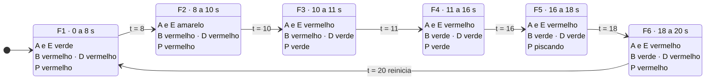

# Diagramas de estados — simulação de semáforos

`t` = tempo dentro do ciclo. O ciclo reinicia sozinho (`t mod 20`).

Invariantes (testados em 1 h simulada):
- **B nunca verde junto com A** (B é o oposto de A, com 1 s de folga em F3).
- **D abre quando E fecha** (F3) e **não depende de C**.
- Pedestre só entra na faixa em **P verde**; em **P piscando** só termina quem já está dentro.

> Vide [simulação](desafio/8p1/index.html) com mais detalhes do que realmente precisa;