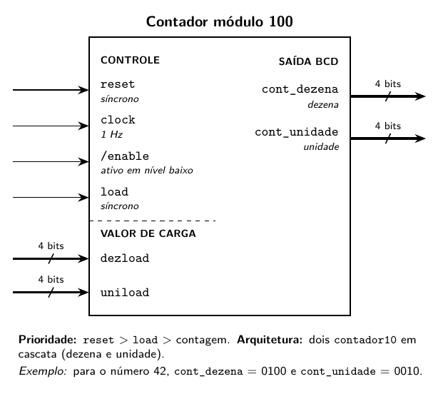
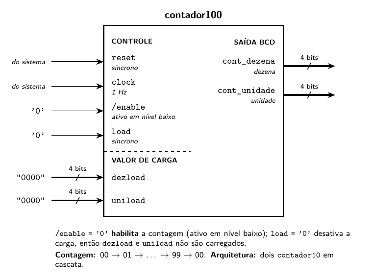
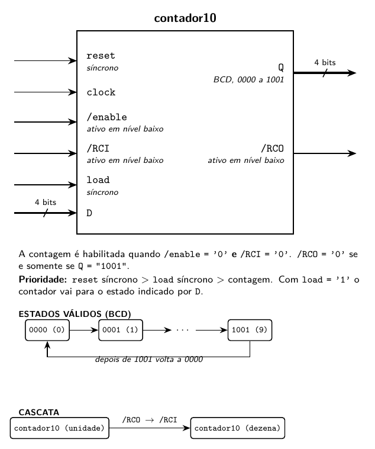
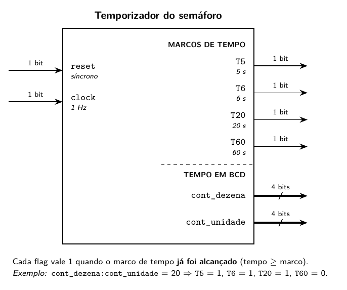
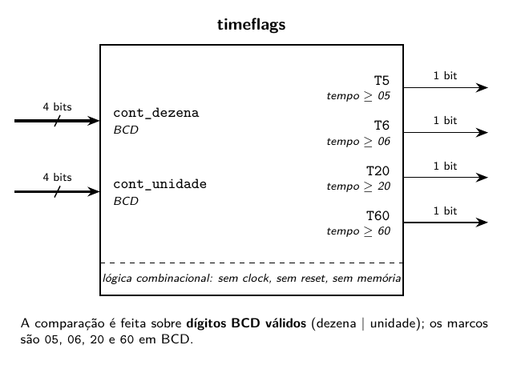
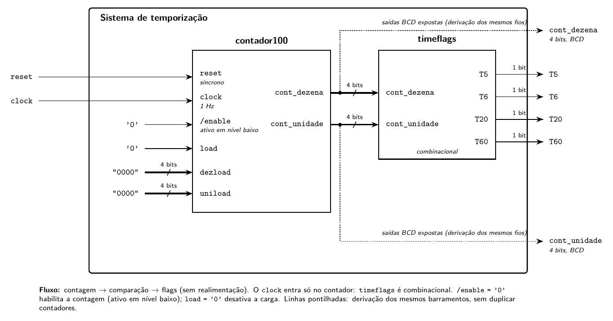
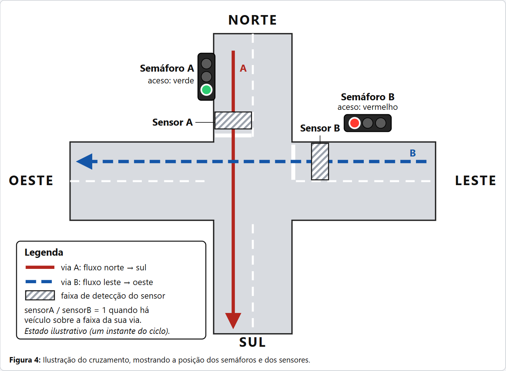
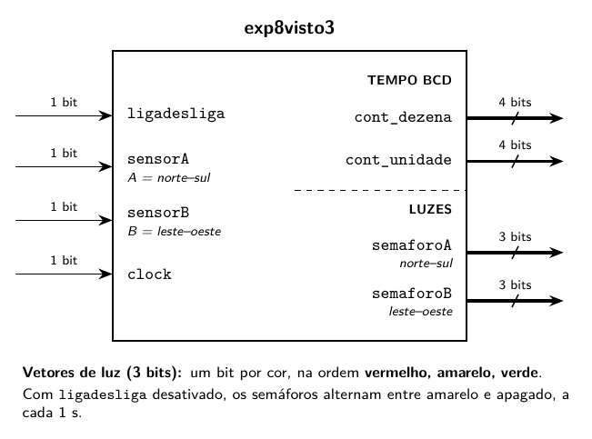
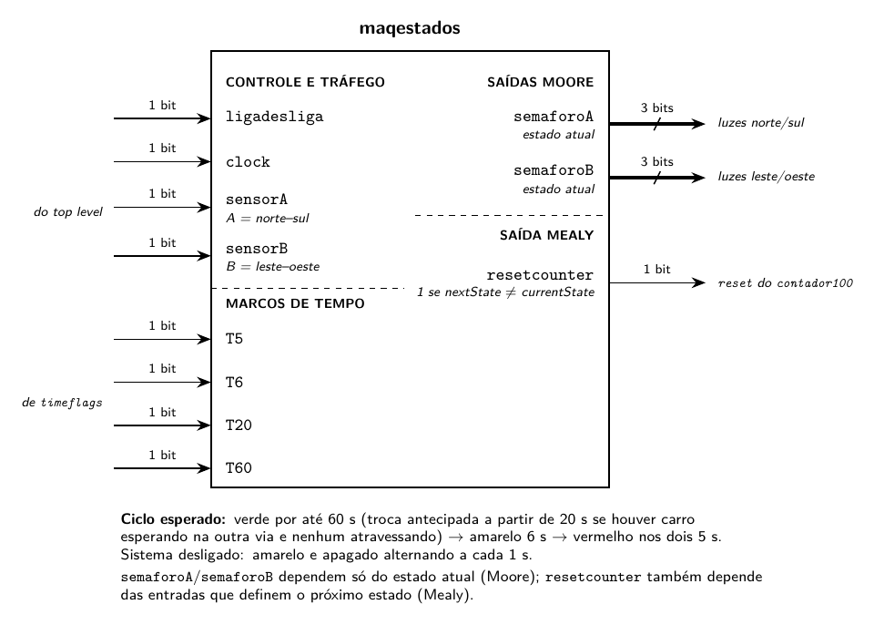

# Laboratório de Sistemas Digitais — Experimento 08

> Conversão de [`Roteiro_08_v3.pdf`](Roteiro_08_v3.pdf) para Markdown.
> Texto transcrito do PDF; erros de digitação óbvios foram corrigidos (lista em [`CLASSIFICACAO_ILUSTRACOES.md`](CLASSIFICACAO_ILUSTRACOES.md#apêndice-b--correções-de-digitação-feitas-na-conversão)).
> As ilustrações originais foram **substituídas** pelas versões redesenhadas em [`resultados/`](resultados/) (imagens em `../assets/images/`). Abaixo de cada imagem, um marcador `[FIGURA …]` indica o formato de origem.
>
> Legenda dos marcadores: **TikZ** = LaTeX (TikZ), **HTML** = SVG/HTML, **MD** = Markdown nativo.

---

## Objetivos

- Projetar e implementar, usando a linguagem VHDL, um sistema de controle de semáforos.
- Implementar contadores em VHDL.
- Fixar o uso de técnicas de projeto modular em VHDL, desenvolvendo grandes sistemas construídos utilizando outros sistemas menores, interligados entre si.

## Instruções

- O experimento deve ser realizado utilizando o ModelSim;
- Cada experimento será avaliado por meio do relatório técnico e dos códigos submetidos pelo aluno, por meio da plataforma Aprender. Os códigos devem ser submetidos comprimidos em um único arquivo.
- A sua simulação deve incluir o arquivo vhdl contendo a entidade (*entity*), a arquitetura (*architecture*) do circuito e o arquivo vhdl do *test bench* desenvolvido para simulá-los. Conforme descrito no guia de uso, o seu relatório deve conter os códigos, as telas de compilação e simulação do ModelSim e as formas de ondas obtidas com a simulação.
- O relatório é individual e receberá uma nota de 0 a 10, considerando os seguintes aspectos:
  - Documentação do código, contida no relatório (pdf) e no código vhdl — 20% da nota do projeto;
  - Compilação do código, apresentada no relatório do projeto e confirmado pelo código vhd — 10% da nota do projeto;
  - Simulação do código, apresentada no relatório do projeto e confirmado pelo código vhd — 70% da nota do projeto.
- Os códigos VHDL das entidades e arquiteturas desenvolvidas neste experimento e no experimento anterior serão utilizadas em experimentos futuros para construir sistemas mais complexos.

---

## Questão 01

Implementar um <u>contador módulo 100</u> com <u>saída BCD</u>, com entradas de ‘reset’ e ‘load’ síncronas, clock de 1 Hz e entrada de ‘enable’ (ativa em nível baixo). A caixa preta e o diagrama de blocos da arquitetura interna desse sistema são apresentados na Figura 1.



> **[FIGURA 1 — TikZ]** Caixa preta (a) do sistema a ser implementado na questão 1.

A entidade `contador100` (Figura 2a) implementa o contador de 100 tempos em si. Trata-se de um contador que, a cada ciclo de clock, conta de 0 a 99 em representação BCD, isto é, com duas saídas de 4 bits que representam, respectivamente, o dígito da dezena e o da unidade. Para implementar este contador de módulo 100, você deve utilizar (como componentes) dois contadores de módulo 10. Pesquise sobre como cascatear contadores de módulo 10 (Figura 2b) de modo a construir contadores de módulo 100, módulo 1000, etc.



> **[FIGURA 2(a) — TikZ]** Caixa preta da entidade `contador100`.



> **[FIGURA 2(b) — TikZ]** Caixa preta da entidade `contador10`.

*Figura 2: Caixas pretas das entidades `contador100` (a) e `contador10` (b).*

O **contador de módulo 10** será implementado pela entidade `contador10`, cuja caixa preta é mostrada na Figura 2b. Este contador de módulo 10 deve ser implementado como uma máquina de estados do tipo **Moore**. Essa máquina terá 10 estados, cada um associado a uma saída de 4 bits: de “0000” (decimal 0) até “1001” (decimal 9). As transições de estado serão controladas pelas variáveis de entrada:

- `reset` (que, de forma síncrona, leva a máquina de volta ao estado inicial se `reset = '1'`);
- `enable` e `RCI` (que são ativas em nível baixo, ou seja, a contagem está ativada quando `enable = '0'` e `RCI = '0'`; `RCI` vem da sigla em inglês *ripple carry-in*);
- `load` e `D` (de forma síncrona, a máquina deve ser levada ao estado indicado por `D` se `load = '1'`).

A saída `RCO` (sigla do inglês *ripple carry-out*) é ativa em nível baixo, e deverá ser ‘0’ se e somente se `Q = '1001'`, caso contrário será ‘1’. Esta saída é usada para cascatear contadores de módulo 10, de modo a construir contadores de módulo 100, módulo 1000, etc. A ação de ‘reset’ deve ter prioridade sobre a ação de ‘load’, que por sua vez deve ter prioridade sobre a contagem.

---

## Questão 02

Implemente um sistema de temporização do controle de semáforos, com ‘reset’ síncrono, clock de 1 Hz, quatro saídas binárias, indicando que já se passaram, respectivamente, 5 segundos (`T5`), 6 segundos (`T6`), 20 segundos (`T20`) e 60 segundos (`T60`). A caixa preta da arquitetura interna desse sistema é apresentada na Figura 3(a).



> **[FIGURA 3(a) — TikZ]** Caixa preta do sistema de temporização (Questão 2).



> **[FIGURA 3(b) — TikZ]** Entidade `timeflags`.



> **[FIGURA 3(c) — TikZ]** Sistema a ser implementado na questão 2: `contador100` + `timeflags`.

*Figura 3: Caixa preta (a) e diagrama de blocos da arquitetura interna (b) e sistema a ser implementado na questão 2 (c).*

Na Figura 3(c) é apresentado o sistema completo a ser implementado. A entidade `timeflags` (Figura 3b) é responsável por verificar se já se passaram, respectivamente, 5 segundos (`T5`), 6 segundos (`T6`), 20 segundos (`T20`) e 60 segundos (`T60`). As entradas são dois números em representação BCD, dezena e unidade, e as saídas são os quatro flags indicadores: `T5`, `T6`, `T20` e `T60`.

Esses flags indicadores podem ser implementados usando atribuições condicionais (estrutura “when-else”) e os operadores de comparação da linguagem VHDL, conforme exemplificado a seguir. Trata-se de um circuito puramente combinacional, não sendo necessário o uso de uma estrutura “process”.

> **[FIGURA — MD]** Na versão em PDF este trecho é uma captura de tela do código. Aqui virou bloco de código selecionável.

```vhdl
Ya <= '1' when (A >  x"35") else   -- operador "maior que"
      '0';

Yb <= '1' when (A >= x"35") else   -- operador "maior ou igual"
      '0';

Yc <= '1' when (A <  x"35") else   -- operador "menor que"
      '0';

Yd <= '1' when (A <= x"35") else   -- operador "menor ou igual"
      '0';

Ye <= '1' when (A =  x"35") else   -- operador "igual a"
      '0';

Yf <= '1' when (A /= x"35") else   -- operador "diferente de"
      '0';
```

Nos exemplos acima, `x"35"` é a representação em hexadecimal do número binário de 8 bits “00110101”, o qual, em representação BCD, corresponde ao decimal 35, pois os quatro primeiros bits (“0011”) correspondem ao número decimal 3 e os quatro últimos (“0101”) correspondem ao número decimal 5. Você pode usar a representação hexadecimal para evitar escrever longas sequências de bits. Por exemplo, o número `x"13F7"` corresponde ao número binário “0001001111110111”.

---

## Questão 03

Implemente o sistema de controle de semáforos com três bits de entrada (sensor de carros na direção norte/sul, sensor de carros na direção leste/oeste e chave de liga/desliga do sistema) e saídas representando os estados dos semáforos e o temporizador/contador (luzes verde, amarela e vermelha de cada direção e estado do contador). O cruzamento é ilustrado na Figura 4.



> **[FIGURA 4 — HTML/SVG]** Ilustração do cruzamento, mostrando a posição dos semáforos e dos sensores.

*Figura 4: Ilustração do cruzamento, mostrando a posição dos semáforos e dos sensores.*

O cruzamento deverá ficar liberado para determinada direção (luz verde) e bloqueado na outra direção (luz vermelha) por 60 segundos, exceto caso haja carro esperando na direção oposta e não haja carros atravessando na direção em questão e já se tenha passado pelo menos 20 segundos. Antes de trocar a pista liberada, o semáforo deverá mostrar a luz amarela (com luz vermelha no outro semáforo) por 6 segundos e, em seguida, a luz vermelha (em ambos os semáforos) por 5 segundos. A qualquer momento, se a chave de liga/desliga for desativada, os semáforos deverão entrar em estado intermitente, no qual alternarão entre a luz amarela e nenhuma luz acesa, com intervalo de 1 segundo entre cada, devendo voltar a qualquer momento ao funcionamento normal caso a chave seja reativada.

Mais especificamente, o sistema deve ser implementado com as seguintes entradas:

- `sensorA`: 1 bit que indica se há carros na direção norte/sul;
- `sensorB`: 1 bit que indica se há carros na direção leste/oeste;
- `ligadesliga`: 1 bit que indica se a chave de liga/desliga do sistema foi acionada;

e as seguintes saídas:

- `semaforoA`: 3 bits indicando quais das luzes (vermelha, verde e amarela) do semáforo da direção norte/sul estão acesas;
- `semaforoB`: 3 bits indicando quais das luzes (vermelha, verde e amarela) do semáforo da direção leste/oeste estão acesas;
- contador de tempo: 4 bits para representar as unidades e 4 bits para representar as dezenas do contador de tempo implementado nas questões anteriores.

A caixa preta desse sistema é apresentada na Figura 5a. Serão usadas (como componentes) todas as entidades utilizadas na arquitetura interna da entidade da questão 2 e uma nova entidade: `maqestados`, que será detalhada a seguir.



> **[FIGURA 5(a) — TikZ]** Caixa preta da entidade `exp8visto3`.
> ⚠ O original rotula **duas** saídas como `semaforoA`; a segunda deve ser `semaforoB`.



> **[FIGURA 5(b) — TikZ]** Caixa preta da entidade `maqestados`.
> ⚠ Mesmo erro: o original rotula as duas saídas de 3 bits como `semaforoA`.

*Figura 5: Caixas pretas das entidades `exp8visto3` (a) e `maqestados` (b).*

A entidade `maqestados` é a responsável por implementar o controle dos semáforos. A caixa preta dessa entidade é apresentada na Figura 5b. Deve ser implementada como uma máquina de estados, com duas saídas do tipo **Moore** — dois vetores de 3 bits `semaforoA` e `semaforoB`, que indicarão se as luzes vermelho, amarelo e verde dos semáforos das pistas norte/sul e leste/oeste, respectivamente, estarão acesas ou não (1 bit para cada cor, nessa ordem) — e uma saída do tipo **Mealy** — um sinal de 1 bit `resetcounter`, que indicará quando o contador de tempo deverá ser reinicializado.

As transições de estado serão controladas pelas variáveis de entrada `ligadesliga`, `sensorA`, `sensorB`, `T5`, `T6`, `T20` e `T60`. As três primeiras serão associadas às entradas de mesmo nome da entidade “top level” (Figura 5(a)) e as quatro últimas às saídas da entidade `timeflags`. O cruzamento deverá ficar liberado para determinada direção (luz verde) e bloqueado na outra direção (luz vermelha) por 60 segundos, exceto caso haja carro esperando na direção oposta e não haja carros atravessando na direção em questão e já se tenha passado pelo menos 20 segundos. Antes de trocar a pista liberada, o semáforo deverá mostrar a luz amarela (com luz vermelha no outro semáforo) por 6 segundos e, em seguida, a luz vermelha (em ambos os semáforos) por 5 segundos. A qualquer momento, se a chave de liga/desliga for desativada, os semáforos deverão entrar em estado intermitente, no qual alternarão entre a luz amarela e nenhuma luz acesa, com intervalo de 1 segundo entre cada, devendo voltar a qualquer momento ao funcionamento normal caso a chave seja reativada.

Note que a entidade `maqestados` deve, por meio da saída `resetcounter`, reinicializar o contador de tempo (implementado pela entidade `contador100`), isto é, fazer a saída `resetcounter = '1'`, sempre que a máquina estiver se preparando para mudar de estado, isto é, se o estado seguinte (`nextState`) for diferente do estado atual (`currentState`). Note que esta é uma saída do tipo Mealy, pois depende não só do estado atual, mas também das variáveis de entrada (que efetivamente determinam o estado seguinte). Isto pode ser implementado com uma lógica combinacional de estado seguinte, atribuindo um valor (‘0’ ou ‘1’) a `resetcounter` sempre que um valor for atribuído à variável de estado seguinte (`nextState`). A implementação de máquinas de estado Mealy em VHDL é discutida em maiores detalhes no documento “Implementando máquinas de estados síncronas do tipo Mealy em VHDL”.
